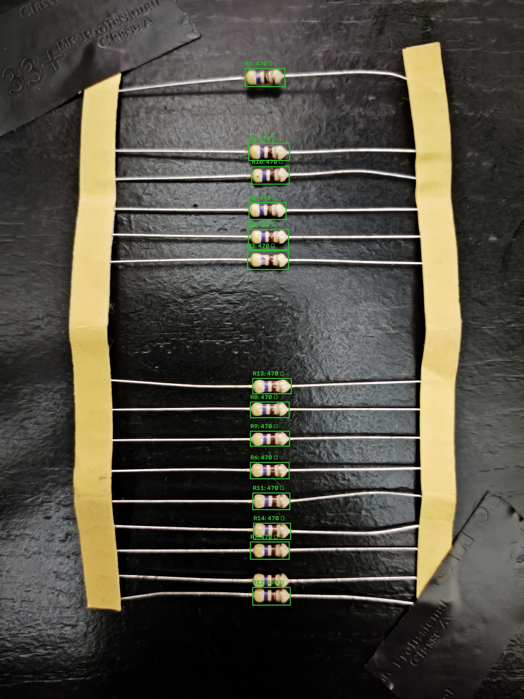

# Detector de resistores

Projeto para contar resistores e estimar seus valores a partir das faixas de cores em imagens e vídeos.

## Documentação completa

O estado técnico, datasets, fontes, métodos, resultados, comandos Windows/Linux, uso no pedrogpu e pendências estão reunidos em [docs/PROJECT_STATUS.md](docs/PROJECT_STATUS.md).

Os relatórios detalhados de benchmark ficam em [benchmarks/EXECUTION_REPORT.md](benchmarks/EXECUTION_REPORT.md), [benchmarks/SOURCES_STATUS.md](benchmarks/SOURCES_STATUS.md) e [benchmarks/SOURCES_AND_APPROACHES.md](benchmarks/SOURCES_AND_APPROACHES.md).

## Estado atual

## Exemplo de detecção em imagem real

A imagem abaixo mostra a última saída anotada do modo especializado para fita. O sistema detectou 14 resistores e identificou 470 ohms em 14 de 14 componentes.



Resultado registrado: contagem 14/14 e leitura 470 ohms em 14/14.

Este primeiro MVP já fornece:

- detecção de objetos candidatos por contornos usando OpenCV;
- contagem de resistores detectados em cada imagem/quadro;
- classificação inicial das faixas de cores;
- decodificação de resistores de 4 ou 5 faixas;
- anotação visual da imagem ou vídeo;
- saída JSON para facilitar integração com outros sistemas.

Além do MVP clássico, o repositório já contém detector YOLO, segmentação, CNN baseada no artigo de Caoile, comparação MATLAB, tracking de vídeo e um modo especializado para fitas com vários resistores. O melhor resultado registrado combina localização YOLO, alinhamento do recorte e decodificação física das faixas.

## Instalação

No Windows PowerShell:

```powershell
py -m venv .venv
.\.venv\Scripts\Activate.ps1
python -m pip install -e ".[dev]"
```

## Uso

Imagem:

```powershell
resistor-detector image caminho\para\imagem.jpg --band-count 4 --output outputs\imagem-anotada.jpg
```

Vídeo, processando um quadro a cada cinco:

```powershell
resistor-detector video caminho\para\video.mp4 --every-n-frames 5 --output outputs\video-anotado.mp4
```

Sem instalar o comando globalmente, também é possível executar:

```powershell
python -m resistor_detector image caminho\para\imagem.jpg
```

O comando imprime um JSON com a quantidade encontrada, caixas delimitadoras, faixas identificadas e valor estimado em ohms.

## Reprodução do baseline do artigo Caoile

O dataset local mais provável do artigo é `barrettotte/resistors`, em `data/sources/kaggle-barrettotte/`. O módulo `caoile_cnn` reproduz o fluxo de classificação por imagem descrito no PDF: entrada 64x64, valores normalizados para 0-1, augmentations, duas convoluções com ReLU e pooling 2x2, camada densa de 128, Adam, divisão 80:20 e early stopping.

Para instalar as dependências opcionais e treinar:

```powershell
python -m pip install -e ".[cnn]"
resistor-caoile-cnn train --dataset data/sources/kaggle-barrettotte
```

O PDF não informa a quantidade de filtros nem os parâmetros das augmentations. Os defaults usados são 32/64 filtros, rotação de 15 graus e brightness de 0,2; todos podem ser alterados pela CLI. O processo do artigo é um classificador com resistor dentro de uma região-guia, não um detector YOLO implementado.

## Benchmark executado e GPU remota

O relatório completo está em [`benchmarks/EXECUTION_REPORT.md`](benchmarks/EXECUTION_REPORT.md). Ele separa localização, contagem, bandas, valor e desempenho e registra limitações de cada fonte.

O inventário técnico fonte por fonte está em [`benchmarks/SOURCES_AND_APPROACHES.md`](benchmarks/SOURCES_AND_APPROACHES.md). Ele registra o que cada material propõe, quais datasets foram baixados, quais métodos foram executados e quais dependem de arquivo/credencial ainda indisponível.

A comparação do fluxo MATLAB original com a porta Python está em `tools/benchmark_matlab_comparison.py`. Ela usa as imagens do próprio pacote MATLAB e grava os resultados em `data/results/matlab-comparison/`. Se o MATLAB possuir o Image Processing Toolbox, o harness usa as funções nativas; caso contrário, usa os shims locais documentados no relatório.

Para contar e identificar vários resistores numa única imagem, execute `tools/combined_multi_resistor.py`. Ele combina o detector agregado, a segmentação YOLO por instância e o decoder de bandas HiRes, com fallback MATLAB-compatível para imagens fora do domínio do segmentador de bandas. O benchmark MATLAB final obteve contagem exata em 16/16 imagens, decodificação de 39/39 resistores e recall de valores de 37/39. Os JSONs e imagens anotadas ficam em `data/results/combined-multi-resistor-matlab/` no `pedrogpu`.

```bash
python tools/combined_multi_resistor.py --device 0
```

O script também funciona no Windows trocando o interpretador por `.venv\\Scripts\\python.exe` e aceitando caminhos Windows nos argumentos `--input`, `--detector`, `--segmenter` e `--hires-seg-weights`.

Para reproduzir o ResistorPrediction original, instale o extra legado com `python -m pip install -e ".[legacy]"` e execute `python tools/benchmark_resistorprediction_original.py`. Para segmentacao YOLO, use `tools/prepare_yolo_segmentation.py` e `tools/train_yolo_segmentation.py`; os pesos e metricas do experimento Alptugaydin ficam em `data/results/yolo-seg-alptugaydin-5060/`.

O benchmark do [Automatic Component Analyzer](https://github.com/bytesizedengineering/automatic-component-analyzer) esta em `tools/benchmark_automatic_component_analyzer.py`. Ele reproduz o caminho de um frame sem GUI/camera, mede os defaults e testa 56 combinacoes dos dois controles do projeto. Os resultados ficam em `data/results/automatic-component-analyzer-comparison/`.

O dataset geral agregado, seus manifestos e as regras de procedencia estao descritos em [`benchmarks/GENERAL_DATASET.md`](benchmarks/GENERAL_DATASET.md). O detector agregado final (15 epocas na RTX 5060) obteve precisao 0,9114, recall 0,9318, F1 0,9215, mAP50 0,9361 e mAP50-95 0,7511. O checkpoint fica em `data/results/general-yolo-5060/train/weights/best.pt` no `pedrogpu`.

Os treinos neurais finais foram executados no host `pedrogpu` com RTX 5060. O detector pode ser reproduzido com:

```bash
python tools/train_yolo_baseline.py \\
  --data-yaml data/derived/general-dataset/yolo/data.yaml \\
  --ground-truth data/derived/general-dataset/object-detection-manifest.jsonl \\
  --output-dir data/results/general-yolo-5060 \\
  --epochs 15 --imgsz 640 --batch 16 --device 0
```

O híbrido detector + decodificador está em `tools/run_hybrid_benchmark.py` e aceita `--decoder classical` ou `--decoder cnn`.

Para repetir a matriz clássica/segmentação no Linux remoto, use o executor retomável:

```bash
cd /home/pedro/detector-resistores
PYTHONPATH=src .venv/bin/python tools/run_benchmark_matrix.py \
  --manifest data/manifests/electronic-components-resistor-detection.jsonl \
  --strategies classical-lab-pca segmentation-rule hybrid-4 hybrid-5 hybrid-auto \
  --resume
```

Os testes de vídeo sintético e robustez ficam em `tools/benchmark_video.py` e `tools/benchmark_robustness.py`. Ambos aceitam caminhos relativos e funcionam no Windows e no Linux; no Windows, troque `.venv/bin/python` por `.venv\\Scripts\\python.exe`.

O export Alptugaydin também possui polígonos VIA em `train.json`. A avaliação pixel-a-pixel está em `tools/benchmark_segmentation_masks.py`; para treinar a U-Net experimental:

```bash
PYTHONPATH=src .venv/bin/python tools/train_unet_segmentation.py \
  --annotation data/sources/kaggle-alptugaydin/extracted/train.json \
  --image-dir data/sources/kaggle-alptugaydin/extracted/train \
  --output data/results/unet-alptugaydin-5060/model.pt \
  --metrics data/results/unet-alptugaydin-5060/metrics.json
```

O decoder composicional de faixas, treinado a partir dos valores e tolerâncias codificados nas pastas Barrettotte, está em `src/resistor_detector/band_decoder.py` e é exposto como `resistor-band-decoder`.

## Teste em fita com vários resistores

Para as fotos de resistores repetidos em fita, use `--strip-mode`. O modo trabalha em alta resolução, filtra a geometria do corpo, recupera candidatos pela faixa amarela e aplica consenso de valor quando um crop está desfocado.

```bash
PYTHONPATH=src .venv/bin/python tools/combined_multi_resistor.py \
  --input data/inputs/user-images \
  --output-dir data/results/combined-user-images-strip-v2 \
  --device 0 --imgsz 1280 --strip-mode --reference ''
```

Teste executado na RTX 5060 de `pedrogpu`: 57 resistores nas quatro imagens, todos identificados como `470 Ω` (`100%` dos valores). Resultado anotado: `data/results/combined-user-images-strip-v2/`.

## Estrutura

```text
src/resistor_detector/
├── cli.py         # interface de linha de comando
├── colors.py      # cores e código de faixas
├── detection.py   # candidatos e amostragem das faixas
├── models.py      # modelos de dados
└── pipeline.py    # fluxo para imagem e vídeo
tests/             # testes unitários
```

## Limitações conhecidas

1. O export Alptugaydin possui polígonos VIA em `train.json`; eles já foram usados no benchmark pixel-a-pixel e no treino da Tiny U-Net. A U-Net ainda é experimental, com 128 imagens e sem teste externo independente.
2. Não há vídeo real anotado. O benchmark temporal usa vídeo sintético com transformação geométrica controlada.
3. Os exports Roboflow de componentes não têm valor em ohms/faixas; neles são válidas métricas de detecção, não de leitura.
4. O decoder de faixas treinado no Barrettotte teve baixo desempenho; o próximo ganho esperado é obter anotações independentes de bandas e alinhar o recorte pelo eixo do resistor.
